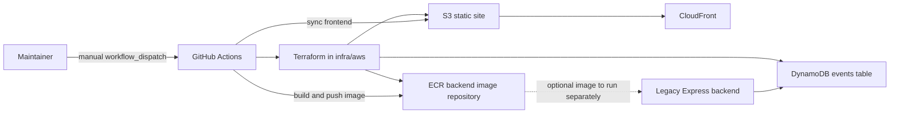

# CrowdOS: Smart Stadium Assistant

CrowdOS is a React stadium operations and fan-guidance demo. It combines simulated crowd and queue data, local graph routing, optional Gemini assistance, and Firebase Auth/Firestore. Routing and local AI fallbacks continue working when remote services are unavailable.

**Live demo:** [CrowdOS on Vercel](https://ai-crowd-intelligence-smart-stadium.vercel.app)

## Architecture

### Vercel + Firebase

```mermaid
flowchart LR
  Fan --> Vercel[Vercel: React SPA + /api serverless functions]
  Vercel --> Auth[Firebase Auth: anonymous sessions]
  Vercel --> Firestore[Firestore: user preferences]
  Vercel --> Chat[/api/chat]
  Vercel --> Analyze[/api/analyze]
  Chat --> Gemini[Google Gemini API]
  Analyze --> Gemini
  Vercel --> Local[Browser: Dijkstra routing + offline fallbacks]
```

### Optional AWS showcase



The AWS showcase is isolated from application runtime. It is only provisioned by a manual workflow; its backend image is stored in ECR, not attached to always-on compute.

## Tech stack

- React 18, Vite, Tailwind CSS, and React Router
- Vercel static hosting and Node.js serverless functions
- Firebase anonymous Auth and Firestore (no Firebase Hosting or Functions)
- Google Gemini API via server-only `@google/genai`
- Local crowd prediction and Dijkstra routing with accessible-mode constraints
- Optional AWS showcase: Terraform, S3, CloudFront, DynamoDB, ECR, and AWS Budgets

## Local setup

Requirements: Node.js 22 and npm.

```powershell
npm install
Copy-Item .env.example .env
npm run dev
```

`npm run dev` starts the Vite UI only; without a local API runtime, AI requests fail over to the built-in offline responses. To run both the UI and API routes locally, link the project and run `npx vercel dev`. Set `GEMINI_API_KEY` and `GEMINI_MODEL` in the local `.env` for server-side Gemini calls. Do not prefix either with `VITE_`.

If Firebase config is absent, the app uses demo behavior. If Gemini is unavailable, the frontend keeps its local chat and operations-analysis fallbacks; route calculation always runs locally.

## Environment variables

| Variable | Where | Required | Purpose |
|---|---|---:|---|
| `VITE_FIREBASE_API_KEY` | Browser build | For Firebase | Firebase web-app config; public identifier, restrict it in Google Cloud |
| `VITE_FIREBASE_AUTH_DOMAIN` | Browser build | For Firebase | Firebase Auth domain |
| `VITE_FIREBASE_PROJECT_ID` | Browser build | For Firebase | Firebase project ID |
| `VITE_FIREBASE_APP_ID` | Browser build | For Firebase | Firebase web-app ID |
| `VITE_FIREBASE_STORAGE_BUCKET` | Browser build | Optional | Firebase Storage config (Storage is not currently used) |
| `VITE_FIREBASE_MESSAGING_SENDER_ID` | Browser build | Optional | Firebase web-app config |
| `VITE_FIREBASE_MEASUREMENT_ID` | Browser build | Optional | Firebase Analytics config |
| `GEMINI_API_KEY` | Vercel server environment | For Gemini | Private Gemini API key; never expose to browser |
| `GEMINI_MODEL` | Vercel server environment | Optional | Gemini model ID; defaults to `gemini-3.5-flash-lite` |

Copy [.env.example](./.env.example) for local values. `.env` is ignored by Git. Firebase web configuration is used by the browser; Gemini credentials are server-only. See the [official Gemini model list](https://ai.google.dev/gemini-api/docs/models) for current model availability.

## Checks

```powershell
npm run lint
npm test
npm run build
```

## Deployment

### Vercel + Firebase

1. Create a Firebase project, register a web app, enable Anonymous sign-in, and create a Firestore database.
2. Add the `VITE_FIREBASE_*` values and server-side `GEMINI_API_KEY`/`GEMINI_MODEL` to Vercel project environment settings. Configure Firebase Auth's authorized domains to include your Vercel domain.
3. Import the repository into Vercel and deploy. Vercel builds the Vite SPA and discovers `api/chat.js` and `api/analyze.js` as serverless functions. `vercel.json` routes SPA paths to `index.html` while API routes remain function endpoints.
4. For GitHub auto-deploys on `main`, configure the `VERCEL_TOKEN` repository secret and `VERCEL_ORG_ID` and `VERCEL_PROJECT_ID` repository variables. The Deploy workflow runs after successful CI on `main`.

No Firebase Blaze plan or Firebase Functions deployment is required.

### AWS showcase (optional)

AWS is not required for local development or the Vercel deployment. Terraform files are isolated in [`infra/aws/`](./infra/aws/).

Prerequisites: Terraform 1.10+, AWS CLI, Docker, AWS credentials, and an existing protected S3 bucket for Terraform state (versioning and encryption enabled).

For the complete showcase deployment, open **Actions → Deploy → Run workflow**. Configure GitHub secrets `AWS_ACCESS_KEY_ID` and `AWS_SECRET_ACCESS_KEY`; repository variable `AWS_TF_STATE_BUCKET`; and the manual workflow inputs for budget-alert email, region, and monthly budget. The workflow also needs the public Firebase `VITE_*` build variables.

Local Terraform provisioning:

```powershell
.\infra\aws\deploy.ps1 -StateBucket YOUR_TF_STATE_BUCKET -BudgetAlertEmail you@example.com
```

Destroy the showcase resources after initializing Terraform with the same backend settings:

```powershell
terraform -chdir=infra/aws destroy `
  -var="aws_region=us-east-1" `
  -var="budget_alert_email=you@example.com"
```

The separately managed state bucket is retained. Back up the showcase website bucket before destroying it. The repository's pre-existing ignored Terraform state under `infrastructure/` is deliberately untouched; review any resources it tracks before operating on an older deployment.

| AWS service | Showcase purpose |
|---|---|
| S3 | Stores the built frontend |
| CloudFront | HTTPS delivery and SPA fallback |
| DynamoDB | Optional event storage for the legacy Express example |
| ECR | Stores the optional backend container image |
| AWS Budgets | Emails when actual monthly costs reach the configured alert threshold |

Vercel's Hobby plan and Firebase Auth/Firestore may be free within their current quotas; Gemini API usage can be chargeable. AWS costs depend on traffic and region and can exceed free-tier allowances. AWS Budgets sends alerts; it is not a spending cap or automatic shutdown.

## How routing works

The stadium map is a graph: zones are nodes and walkable connections are edges. Dijkstra's algorithm selects a route using distance plus crowd-forecast and flow-balancing penalties. Accessible mode excludes stairs-marked nodes. The route engine runs in the browser, so routes remain available when Firebase or Gemini is offline.

## Screenshots

- Home/dashboard: screenshot placeholder
- Fan route and ADA mode: screenshot placeholder
- Operations analyst: screenshot placeholder
