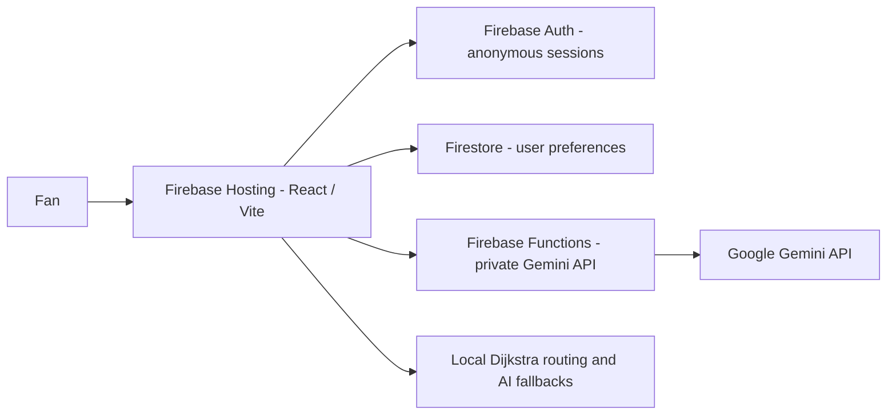
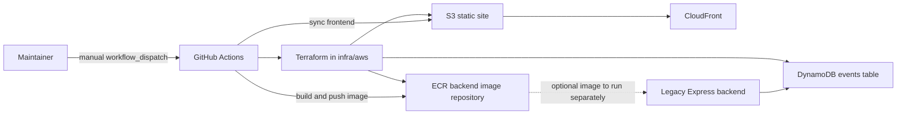

# CrowdOS: Smart Stadium Assistant

CrowdOS is a React stadium operations and fan-guidance demo. It combines simulated crowd and queue data, a local graph-routing engine, optional Gemini assistance, and Firebase services. The main app does not require AWS; navigation remains available when AI or Firebase services are offline.

**Live demo:** [Firebase Hosting URL](https://YOUR_FIREBASE_PROJECT.web.app) (replace with your deployed URL)

## Architecture

### Free-first production path



### Optional AWS showcase



The AWS showcase is not on the app's runtime path. It creates AWS resources only when manually requested; the backend image is stored in ECR but is not attached to an always-on compute service.

## Tech stack

- React 18, Vite, Tailwind CSS, and React Router
- Firebase Hosting, anonymous Firebase Auth, Firestore, and Analytics
- Firebase Functions (Node.js 22) as the server-side Gemini API
- Google Gemini API, with `gemini-3.5-flash-lite` as the default model
- Local crowd prediction and Dijkstra routing with an accessible-mode constraint
- Optional AWS showcase: Terraform, S3, CloudFront, DynamoDB, ECR, and AWS Budgets

## Local setup

Requirements: Node.js 22 and npm. Firebase Emulator use also requires the Firebase CLI; the Functions emulator may require Java.

```powershell
npm install
Copy-Item .env.example .env
npm run dev
```

The app starts in demo mode when Firebase values are missing. Chat and operations analysis use local fallbacks when the Functions API is unavailable. The route engine runs locally either way.

To try Gemini locally, set the web config in `.env`, add the key to `functions/.secret.local` (ignored by Git), and run the Functions emulator in a second terminal:

```text
# functions/.secret.local
GEMINI_API_KEY=your_server_side_gemini_api_key
```

```powershell
firebase emulators:start --only functions --project ai-crowd-intelligence
npm run dev
```

The emulator project must match `VITE_FIREBASE_PROJECT_ID`. The Gemini key is read only by Functions and must never use a `VITE_` prefix.

To override the default Gemini model locally or for deployment, put `GEMINI_MODEL=your-supported-model-id` in `functions/.env`. This file is ignored by Git.

## Environment variables

| Variable | Where | Required | Purpose |
|---|---|---:|---|
| `VITE_FIREBASE_API_KEY` | Browser build | For Firebase | Firebase web-app config; public identifier, restrict it in Google Cloud |
| `VITE_FIREBASE_AUTH_DOMAIN` | Browser build | For Firebase | Firebase Auth domain |
| `VITE_FIREBASE_PROJECT_ID` | Browser build | For Firebase | Project ID; also selects the local Functions emulator project |
| `VITE_FIREBASE_APP_ID` | Browser build | For Firebase | Firebase web-app ID |
| `VITE_FIREBASE_STORAGE_BUCKET` | Browser build | Optional | Firebase Storage config; Storage is not currently used |
| `VITE_FIREBASE_MESSAGING_SENDER_ID` | Browser build | Optional | Firebase web-app config |
| `VITE_FIREBASE_MEASUREMENT_ID` | Browser build | Optional | Firebase Analytics config |
| `GEMINI_API_KEY` | Firebase Functions secret | For Gemini | Private Gemini API key; set through Firebase Secret Manager |
| `GEMINI_MODEL` | Functions environment | Optional | Gemini model ID; defaults to `gemini-3.5-flash-lite` |

Copy [.env.example](./.env.example) for local values. Firebase web config is intended to be visible in a browser; the Gemini key is not. `.env` and Functions local secret files are ignored by Git.

## Checks

```powershell
npm run lint
npm test
npm run build
```

`npm run dev` serves the UI. To exercise Gemini locally, run the Functions emulator alongside it as described above.

## Firebase setup and deployment

1. Create a Firebase project, register a web app, enable Anonymous sign-in, and create a Firestore database.
2. Fill in the `VITE_FIREBASE_*` values in local `.env`.
3. Store the Gemini key as a Firebase Functions secret:

   ```powershell
   firebase functions:secrets:set GEMINI_API_KEY --project YOUR_FIREBASE_PROJECT
   ```

4. Link a billing account if required by Firebase Functions. Functions need the Blaze plan even though the app may remain within the Functions no-cost quota; exceeding quotas can incur charges.
5. In GitHub repository settings, add repository variables `FIREBASE_PROJECT_ID`, `VITE_FIREBASE_API_KEY`, `VITE_FIREBASE_AUTH_DOMAIN`, `VITE_FIREBASE_STORAGE_BUCKET`, `VITE_FIREBASE_MESSAGING_SENDER_ID`, `VITE_FIREBASE_APP_ID`, and optionally `VITE_FIREBASE_MEASUREMENT_ID`.
6. Add the Firebase deploy service-account JSON as the `FIREBASE_SERVICE_ACCOUNT` GitHub secret.
7. Push to `main`. The CI workflow runs on pushes and pull requests; after a successful CI run on `main`, the deploy workflow publishes Hosting and Functions.

Gemini model IDs and lifecycle change over time. The default is listed as stable for new projects in the [official Gemini models documentation](https://ai.google.dev/gemini-api/docs/models). Set `GEMINI_MODEL` to a supported model if you want to change it.

## AWS showcase (optional)

AWS is not required for local development or the Firebase deployment. The isolated Terraform files are in [`infra/aws/`](./infra/aws/).

### Deploy

Prerequisites: Terraform 1.10 or later, AWS CLI, Docker, AWS credentials, and an existing S3 bucket for Terraform state. Enable versioning, encryption, and S3 public-access blocking on the state bucket before use.

For the complete AWS showcase deployment (Terraform resources, frontend upload, CloudFront invalidation, and backend image upload), open **Actions → Deploy → Run workflow** and provide a budget-alert email and budget limit. Configure these GitHub secrets:

- `AWS_ACCESS_KEY_ID`
- `AWS_SECRET_ACCESS_KEY`
- `FIREBASE_SERVICE_ACCOUNT`

Configure these repository variables:

- `AWS_TF_STATE_BUCKET` — pre-created, protected Terraform state bucket
- `FIREBASE_PROJECT_ID`
- The `VITE_FIREBASE_*` build variables listed above

For local Terraform provisioning from PowerShell:

```powershell
.\infra\aws\deploy.ps1 -StateBucket YOUR_TF_STATE_BUCKET -BudgetAlertEmail you@example.com
```

The script provisions Terraform resources. The GitHub manual workflow additionally builds and uploads the frontend and backend container image.

### Destroy

After initializing Terraform with the same S3 backend settings, destroy the showcase resources with:

```powershell
terraform -chdir=infra/aws destroy `
  -var="aws_region=us-east-1" `
  -var="budget_alert_email=you@example.com"
```

The separately managed Terraform state bucket is retained. The S3 website bucket is configured for Terraform destruction; back up anything you want to keep first.
The repository's pre-existing ignored Terraform state under `infrastructure/` is deliberately left untouched; review any resources it tracks before applying or destroying an older AWS deployment.

### AWS services and cost

| Service | Showcase purpose |
|---|---|
| S3 | Stores the built frontend |
| CloudFront | HTTPS delivery for the static site and SPA route fallback |
| DynamoDB | Optional event storage used by the legacy Express example |
| ECR | Holds the optional backend container image |
| AWS Budgets | Sends an email when actual monthly cost exceeds 80% of the configured budget |

The Firebase path can be $0 within applicable no-cost quotas, but Firebase Functions requires a billing-enabled project and Gemini usage may be chargeable. AWS costs vary with traffic, storage, requests, and region; low-volume use may be within free-tier allowances or a few dollars monthly, but can exceed that. The budget notification is an alert, not a spending cap or automatic shutdown.

## How routing works

The stadium map is represented as a graph: named zones are nodes and traversable connections are edges. Dijkstra's algorithm selects a route using physical distance plus a crowd-forecast penalty, with a deterministic balancing penalty to reduce herding. Accessible mode avoids nodes marked as stairs (`isStairs`). Route calculation and local recommendations run in the browser, so they continue to work if Firebase or Gemini is offline.

## Screenshots

- Home/dashboard: screenshot placeholder
- Fan route and ADA mode: screenshot placeholder
- Operations analyst: screenshot placeholder
